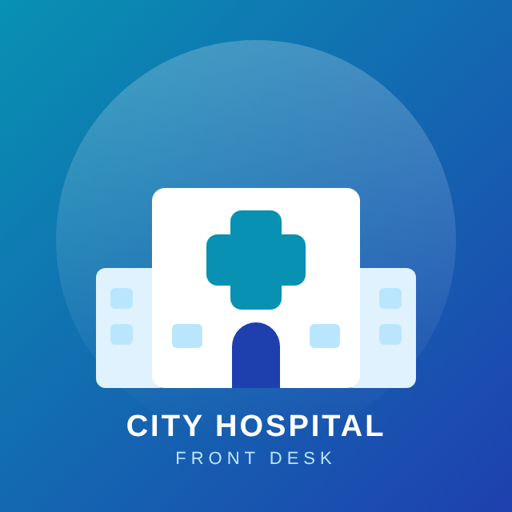
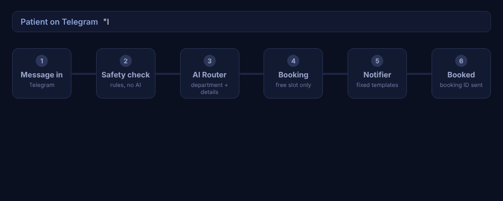
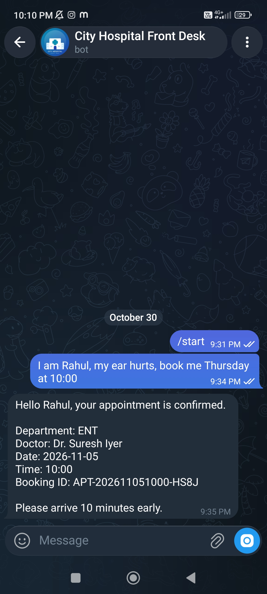
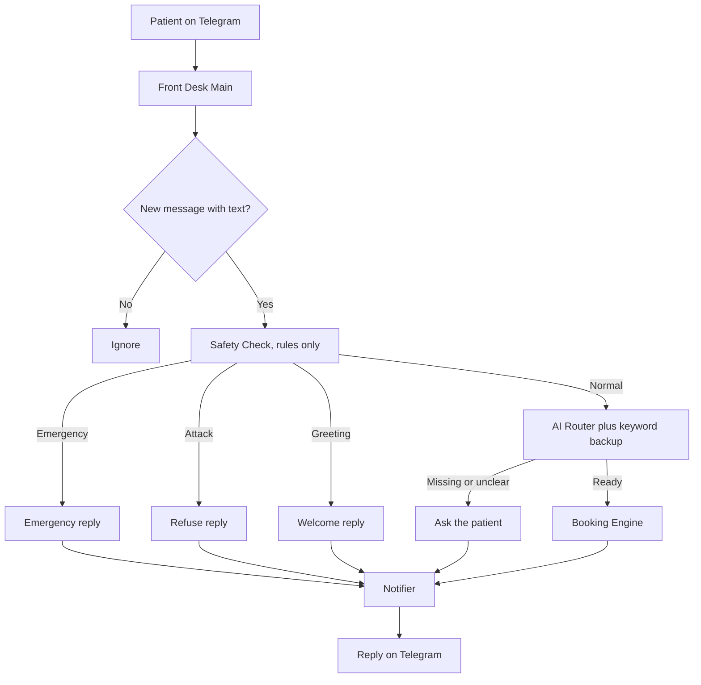

  

<h1 align="center">City Hospital Front Desk Bot</h1>

  A Telegram bot that books doctor appointments for a hospital front desk, built with n8n. 
  It never gives medical advice.

  

## What it does

- Checks every message with plain rules first, with no AI. Emergencies get a fixed "call emergency services" reply. Prompt-injection attempts get refused.
- Uses one AI call to pick the department and read the name, date and time.
- Has a keyword and date backup in code, so the bot keeps working when the AI is wrong or out of quota.
- Books a free slot with a booking engine. Two patients can never get the same doctor, date and time.
- Ignores duplicate and empty Telegram messages.
- Logs every message, alerts the owner on errors, and sends a daily report.
- Understands English and Hinglish.

## See it working

  

A patient writes "I am Rahul, my ear hurts, book me Thursday at 10:00". The bot picks ENT, finds a free slot with Dr. Suresh Iyer, books it, and replies with a confirmation and a booking ID.

## How it works

## The 9 workflows

| Workflow | Job |
|---|---|
| HD Front Desk Main | Telegram front door. Calls the others in order. |
| HD Safety Check | Rules for emergencies and attacks, in English and Hinglish. |
| HD AI Router | One AI call, then code checks the reply and adds a backup. |
| HD Booking Engine | Finds a free slot, blocks double booking, saves the booking. |
| HD Notifier | Writes the patient reply from fixed templates and sends it. |
| HD Error Handler | Runs when any workflow fails. Saves the failure and alerts the owner. |
| HD Human Handoff | Asks a receptionist to approve or reject a callback. |
| HD Daily Report | Sends a daily summary to the owner at 9 PM India time. |
| HD Test Suite | Runs saved sample messages and scores the results. |

Data lives in n8n data tables: doctors, appointments, message log, failed messages, test cases and test results.

## Test results

- Full test of 30 messages (12 normal, 6 Hinglish, 6 emergency, 4 attack, 2 unclear): 26 of 30 correct. All emergency, attack and Hinglish cases passed. The 4 misses came from the free AI model.
- After adding the keyword backup, those cases pass. A 5 message run scored 5 of 5.
- An end to end run through the real front desk workflow covered 11 patient scenarios: emergency, attack, greeting, missing details, booking, repeat booking, slot already taken, doctor off that day, past date, unclear request and a Hinglish booking. All 11 behaved correctly.

## Tech

n8n (self-hosted in Docker), Telegram Bot API, OpenRouter free model, ngrok fixed address, n8n data tables.

## Run it yourself

1. Run n8n in Docker with a volume for your data and a public HTTPS address (for example an ngrok free fixed domain) set as `WEBHOOK_URL`.
2. Import the files in `workflows/` into n8n.
3. Add your own Telegram bot credential and OpenRouter credential in n8n.
4. Create the data tables, and put your own chat ID where the files say `OWNER_CHAT_ID_HERE`.
5. Publish the workflows.

## Notes

Built on a free AI model with a small daily limit. The keyword backup keeps the bot working when the AI is wrong or out of quota. The bot only books appointments and does not give medical advice.
